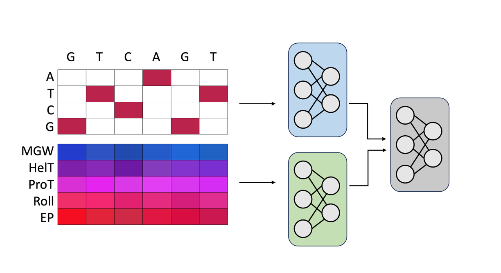

# DeepShape



DeepShape combines DNA sequence with five DNA shape features to predict chromatin measurements and interpret learned binding patterns. It extends the DeeperDeepSEA architecture implemented in [Selene](https://www.nature.com/articles/s41592-019-0360-8). [Manuscript](https://www.biorxiv.org/content/10.1101/2025.04.01.646034v1).

## Install and run the CPU quickstart

Use Python 3.12 on Linux x86-64. A GPU, cluster account, and genome-scale data download are not required for this example.

```bash
git clone https://github.com/ni-lab/DeepShape.git
cd DeepShape
python3.12 -m venv .venv
source .venv/bin/activate
python -m pip install -r requirements.txt
python examples/quickstart.py --train-step
```

The first run downloads the public 231 MB checkpoint and verifies its SHA-256 checksum. The example inputs are included in the repository. Outputs in `quickstart-output/` are:

- `predictions.npy`: predictions for 16 sequences and all 919 tasks, shape `(16, 919)`.
- `encodings.npz` and `attributions.npz`: inputs and DeepLIFT attributions for two sequences, shape `(2, 9, 1000)`; the attribution target is HepG2 MafK (index 504).
- `results.json`: package versions, checkpoint checksum, comparison with reference predictions, and the loss from one demonstration optimizer step.

To use a previously downloaded published checkpoint:

```bash
python examples/quickstart.py --checkpoint /your/path/deepshape.pth.tar
```

This is an installation/workflow check with selected example inputs. It does not estimate benchmark performance. The optimizer check uses a new single-target model; it does not modify the pretrained checkpoint. [Example provenance and exact genomic coordinates](examples/quickstart/manifest.json).

## Train or run the genome-based interpretation workflow

The additional workflow dependencies compile Selene/tabix extensions. They require a C compiler and Python development headers. Conda/Miniforge Python includes the headers; with a system Python on Ubuntu, install the matching development package (for example, `sudo apt-get install build-essential python3.12-dev`).

Install the additional dependencies and the included shape-aware TF-MoDISco modification:

```bash
python -m pip install -r requirements-workflows.txt
python -m pip install ./interpret/tfmodisco-lite-mod
```

The exact resolved dependency versions are recorded in `requirements-tested.txt`.

An alternative conda specification is `environment.yaml`; the original research-environment export is retained as `environment-legacy.yaml`. The pip route above is the installation test target.

### Small CPU training example

The repository includes a miniature FASTA, raw shape HDF5, one-track labels, intervals, and a matching feature list. Coordinates in this fixture are renamed `example_00`, etc.; original hg19 coordinates are recorded in its manifest.

```bash
python examples/prepare_training.py
python utils/run_deepshape.py config/train_quickstart.yml
```

This executes two training steps and evaluation on a small one-target configuration. It checks the same model, genome reader, sampler, and training entry point used in the larger workflow. The tiny splits are for software testing, not scientific evaluation.

### Genome-based DeepLIFT example

After the quickstart has downloaded the checkpoint:

```bash
python interpret/run_deeplift.py config/deeplift_quickstart.yml
```

This uses the original genome-based reader and attribution runner with the bundled miniature genome. Its outputs are written to `quickstart-output/interpret/`.

### Full 919-task training

`config/train_deepshape.yml` describes the original 919-output workflow. Set `DEEPSHAPE_DATA` to your prepared data directory and `DEEPSHAPE_OUTPUT` to your output directory before running it:

```bash
export DEEPSHAPE_DATA=/your/prepared/data
export DEEPSHAPE_OUTPUT=/your/results
python utils/run_deepshape.py config/train_deepshape.yml
```

The configuration resolves `${DEEPSHAPE_ROOT}` automatically, so model/helper paths work from any working directory. Set the data and output directories to absolute paths. The full training template requests CUDA; use the CPU quickstart above to verify installation first.

Required inputs and download locations are documented in [data/README.md](data/README.md) and [data/resources.json](data/resources.json). The indexed target BED for full training must contain the matching 919 labels in `data/distinct_features.txt`. A single-track CTCF tutorial BED is not a replacement for that file. Use the one-target example configuration with one-target data.

## Input conventions

- Model inputs: `(batch, 9, 1000)`.
- Channel order: **A, C, G, T, EP, HelT, MGW, ProT, Roll**.
- `model/deepshape.py` accepts raw shape values and applies the original minibatch min–max normalization during its forward pass.
- `model/deepshape_no_normalize.py` expects inputs already normalized. The genome-based interpretation runner pairs it with `genomeshape_normalize.py`, which uses the global minima/maxima stored in the shape HDF5. The quickstart follows this same interpretation convention.
- Targets are zero-based indices into the **ordered** `data/distinct_features.txt`; index 504 is `HepG2|MafK|None`.
- Single-target sampling requires `sample_negative: True`, as shown in `train_quickstart.yml`.

## Motif discovery

See [interpret/README.md](interpret/README.md). For a suitable collection of positive sequences, run DeepLIFT with `config/deeplift.yml`, then:

```bash
python interpret/run_tfmodisco.py config/tfmodisco.yml
```

The runner invokes the bundled TF-MoDISco modification and stops if a command fails. Shape runs use `--nofliprc` to reverse shape profiles without nucleotide complementation. The two-sequence installation example is too small for meaningful motif discovery; use the full attribution collection for biological analyses.

## Troubleshooting

- **Missing modules:** activate the environment and use `python -m pip`, ensuring that installation and execution use the same interpreter. Install `requirements-workflows.txt` before running the genome reader, training, or motif workflow.
- **Missing checkpoint:** run the quickstart to download it, or supply `--checkpoint` with the published checkpoint. Git LFS pointer text is not a model checkpoint; checksum verification catches this.
- **Wrong output size or target index:** check that the model output count and feature-list length agree. The published checkpoint has 919 outputs; the miniature training example has one.
- **Missing full training data:** the 919-track BED and genome-scale FASTA/HDF5 are external data. The bundled example runs without them; the full template requires the resources listed in `data/README.md`.
- **Slow sampler startup:** the original parallel sampler uses eight workers by default. `n_processes` is configurable; the CPU example uses two. Each worker opens a genome reader. Allow adequate memory and local scratch space for the full genome-scale workflow.

## Checks

```bash
python -m unittest discover -s tests -v
python examples/quickstart.py --train-step
```

The GitHub Actions workflow repeats the CPU quickstart from a clean Python environment.
